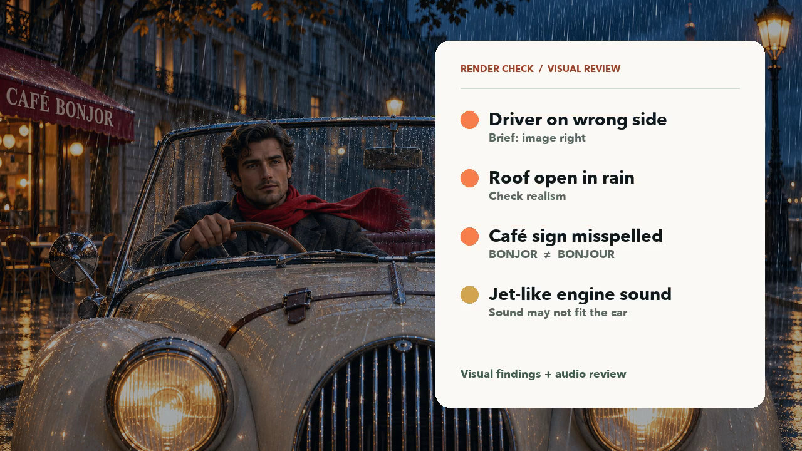

# VOOPA Render Check

## Make every render count.

**The AI quality check between this render and the next.** Find issues, review the evidence and give your next image or video a better starting point—before spending on another take.

Render Check brings multiple visual, audio and delivery checks into your AI workflow. Connect it to a compatible assistant or automation, bring your brief and finished media, and turn “something looks wrong” into a more focused next step.

- **Check more than the obvious.** Inspect for black gaps, freezes, repeated shots, audio gaps and export requirements; compare selected frames and reference audio for a closer look at continuity.
- **Bring your own tools.** Review completed images and videos from different generators, and connect Render Check to compatible MCP agents or n8n workflows.
- **Start small, scale with your workflow.** Try the preview or explore paid credits from $5. [See plans and usage](https://voopa-render-check.onrender.com/plans).

[Explore the checks](CAPABILITIES.md) · [Connect an assistant](ASSISTANT-SETUP.md) · [Get the Claude skill](CLAUDE-SKILL.md) · [See plans](https://voopa-render-check.onrender.com/plans)

**Create. Check. Improve. Repeat with purpose.**

[](https://x.com/VoopaCorp/status/2123381667712676005)

[Watch the 25-second demo](https://x.com/VoopaCorp/status/2123381667712676005) · [Download video](https://github.com/Voopa-Corp/render-check/raw/refs/heads/main/render-check-workflow-v4.mp4) · [Connect your workflow](FAL-WORKFLOW.md) · [Plans and credits](https://voopa-render-check.onrender.com/plans)

This staged example shows how an assistant can review a completed render before another take. [See a real Roadster production example](https://x.com/VoopaApp/status/2123136658967290047).

In this real VOOPA production, a deflector moved off-center. An agent reviewed the frame with Render Check and recommended using an existing better take.

## Add Render Check to your agent

**Runway, Replicate and ComfyUI:** [Explore the workflow setup](integrations/README.md) and [Runway pairing guide](ASSISTANT-SETUP.md#use-alongside-runway). The Replicate and ComfyUI adapters are early previews.


Workflow builders: add the [reusable Render Check agent skill](skills/render-check/SKILL.md) to your project and connect the MCP server below.

Connect the free, rate-limited MCP preview to a compatible agent host:

- **Claude Code:** `claude mcp add --transport http render-check https://voopa-render-check.onrender.com/mcp`
- **Codex:** `codex mcp add voopa-render-check --url https://voopa-render-check.onrender.com/mcp`
- **Cursor and other MCP hosts:** add the Streamable HTTP server URL `https://voopa-render-check.onrender.com/mcp` to your MCP configuration.
- **n8n or fal workflows:** [follow the workflow guide](FAL-WORKFLOW.md) to review a completed render before another take.

Ask your agent: “Before re-rendering this image or video, use Render Check with my brief and the existing take. Show me the evidence and the best next step.” The vision-capable agent examines returned frames; Render Check helps structure the next decision. It accepts completed media from different providers. [Plans and credits](https://voopa-render-check.onrender.com/plans).

## Lyrics comparison

`compare_lyrics_transcript` compares approved lyrics and a supplied transcript of the same sung or spoken excerpt, identifying changed, omitted and additional words. It is a free text-only comparison: it does not transcribe or hear audio. A voice-capable agent or separate transcription service must provide the transcript. Singing and music can cause transcription errors, so listen before claiming the singer made a mistake. It does not judge singing quality or lip sync.

## Shot-list and edit inventory check

`compare_shot_inventory` compares caller-supplied approved shot IDs with a declared timeline inventory, identifying IDs missing from that inventory, repeated or unexpected IDs and ordering differences. If every item has start and end times, it also reports internal gaps and overlaps assuming one track. This free check does not inspect or recognize media; an incomplete inventory cannot establish that a shot is absent from the edit. Review whether differences are intentional before another render.

## Experimental motion checks

The metered endpoint also provides `check_metered_black_gaps`, `check_metered_freezes` and `scan_metered_repeated_shots`. Each charges 5 units per started 5 seconds of the requested interval within the verified video duration. Each check is separately charged, uses an operation ID to prevent duplicate charges, and releases a reservation if inspection fails. These are candidate scans: black scenes, stills and repeated shots may be intentional, and the methods can miss or misidentify material. See [agent billing](AGENT-BILLING.md) for range limits and usage.

`inspect_audio_levels` measures decoded RMS and peak levels, near-full-scale sample percentages and one-second windows over a selected 1–30 second section of a video. An optional second video provides a level difference for a reviewer investigating inconsistent sound between clips. This is not a voice identity or speaker-consistency detector, a perceptual loudness meter, a clipping verdict or a lip-sync check: music, pauses, mixing, stereo downmixing and effects affect the measurements. Near-full-scale samples do not prove clipping, and clipped audio can be below full scale. Listen to the selected intervals. The result reports how many seconds were actually examined. The rate-limited preview offers optional comparison; the paid `inspect_metered_audio_levels` checks one video per call and costs 5 units per started five seconds of the selected interval within the verified video duration. Two clips require separate calls and charges.

`measure_metered_loudness` measures integrated programme loudness and estimated true peak for a selected 3–30 second video interval. It costs 5 units per started five seconds of the validated audio/video interval. Silence is inconclusive for integrated loudness. These values are review evidence, not a verdict on clipping, distortion, platform compliance or voice quality; short excerpts and music can be misleading. Failed checks release reserved units and repeated operation IDs do not charge twice. See [agent billing](AGENT-BILLING.md).

`scan_metered_cross_window_repeats` searches two caller-selected chronological, non-overlapping 4–30 second windows for visually similar two-second passages. It can identify candidates across separately selected portions of a long video; it costs 5 units per started five seconds of the combined windows. It does not search the rest of the film; changed speed, some crops, color changes and brief repeats may be missed, while intentional repeats can be flagged. Review in motion. See [agent billing](AGENT-BILLING.md).

`compare_metered_shot_ranges` compares two caller-selected, non-overlapping 2–8 second ranges, even when they are more than a minute apart. It costs 5 units per started five seconds of their combined length. It is visual similarity evidence, not a whole-video search or a verdict; static scenes and intentional repeats can match, while edited repeats can be missed. See [agent billing](AGENT-BILLING.md).

`measure_metered_region_motion` measures pixel changes in a caller-selected fixed rectangle over a 1–30 second interval. It costs 5 units per started five seconds of the verified interval. Reusing an operation ID cannot charge twice, and failed checks release the reservation. This is evidence for review, not object tracking or proof that steam, people or clothing move naturally; camera motion and scene cuts can mislead. See [agent billing](AGENT-BILLING.md).

`compare_metered_reference_audio` compares a video soundtrack with a supplied reference excerpt over 2–15 seconds. It charges 5 units per started 5 seconds of the verified shared interval. Repeated or rhythmic material may give multiple plausible offsets: `lagAmbiguous` highlights an alternate timing, but does not guarantee an unflagged estimate. It provides one-second and quarter-second similarity windows for locating differences. Very quiet intervals are inconclusive; short windows are sensitive to mixing. Similarity is evidence for review, not voice identification, a lip-sync verdict or proof that either source is correct. See [agent billing](AGENT-BILLING.md).

`compare_metered_continuity` lets a vision-capable agent compare two labeled frames for object counts, positions or continuity for 5 usage units. It prompts the agent to report visible evidence and uncertainty; it is not an automatic object detector and does not verify unsampled moments. See [agent billing](AGENT-BILLING.md).

`prepare_continuity_comparison` returns two labeled frames from two completed videos at requested times, together with a continuity focus, for a vision-capable agent or person to compare. The frames may show changes in clothing, object position or other visible details, but the tool itself does not decide whether a difference is wrong; a pair of stills cannot verify continuous motion, audio or unsampled moments.

`measure_region_motion` reports one-second pixel-change measurements in a caller-selected fixed rectangle over a 1–30 second video range. It may help a reviewer find areas worth checking for stillness. It does not track objects or decide whether motion is realistic: camera movement, cuts, lighting, overlays or occlusion can distort the measurements, and a still area may be intentional. Inspect the footage in motion.

`check_video_export` checks a completed video's container metadata against the delivery requirements you supply: portrait, landscape or square orientation; minimum or maximum duration; and minimum display width and height. For example, an agent can check whether a clip meets a vertical 1080-pixel delivery requirement before choosing to crop or regenerate. The hosted MCP accepts an attachment or a direct public HTTPS URL; local hosts also accept an intake filename. Supply at least one requirement. Rotation metadata is considered, but metadata can be inaccurate. A matching export has not been checked for sharpness, creative content, lip sync or sound, and no result authorizes another paid render.

`check_image_export` checks the encoded dimensions and orientation of a PNG, JPEG or WebP against supplied minimum dimensions or orientation. Encoded pixels can differ from displayed orientation if EXIF metadata is applied. A matching size does not establish sharpness, correct anatomy, legible text or other creative quality; inspect the image separately. Resizing cannot recover missing detail.

`check_black_gaps` flags almost-black passages lasting at least 0.3 seconds in a selected 1–120 second range, returning timestamps in the original video for human review. Intentional fades and dark scenes can be flagged; brief flashes and partial-frame defects may be missed. It does not determine intent or authorize a rerender. For videos over two minutes, select subsequent ranges explicitly.

For brief suspected gaps, optionally set `minimumDurationSeconds` from 0.1 to 3 seconds; the default is 0.3. Shorter thresholds can flag intentional transitions, and very short gaps or partial-frame defects may still be missed.

To try it without sharing a private clip, call `check_black_gaps` with `renderVideoUrl` set to `https://raw.githubusercontent.com/Voopa-Corp/render-check/main/black-gap-demo.mp4`. This synthetic example deliberately contains black frames from 3 to 4 seconds. The hosted preview is free and rate limited.

[Try the repeated-shot scanner on a reproducible demo](REPEATED-SHOT-DEMO.md). [Use the repeated-shot workflow in n8n](N8N-REPEATED-SHOT-WORKFLOW.md).

`scan_repeated_shots` is an experimental opt-in scan for visually similar two-second passages within a selected 4–60 second range. For a longer video, the default is its first 60 seconds; pass `fromSeconds` and `durationSeconds` to scan another section. Timestamps refer to the original video, but repeats across different scan sections will be missed. It lists possible low-motion matches separately (at most five, in addition to at most ten other candidates); a match may be intentional, and a clear result does not rule out repeats. Crops, altered speed, color and transitions can be missed. Review suggested ranges in motion. The scanner does not assess audio or intent, and never approves another render.


Agents can use `check_full_frame_freeze` to flag nearly unchanged full frames, or a caller-selected fixed rectangle, within a selected range of up to 120 seconds. The minimum freeze defaults to one second; set `minimumFreezeSeconds` between 0.25 and 5 for a different threshold. Shorter thresholds may flag more intentional stills. For longer videos, the default is the first 120 seconds; select another range with `fromSeconds` and `durationSeconds`. `check_repeated_sequence` compares two specified 2–8 second ranges for visual similarity. Both return candidates for review, not a creative verdict. Static shots may be intentional; camera motion, cuts, similar scenes, altered crops and occlusion can cause misleading results. The selected rectangle does not track an object. Neither tool verifies steam, audience behavior, sound, lyrics or lip sync, and a clear result does not establish that the video is correct.

`compare_reference_audio` experimentally compares up to 15 seconds of a video soundtrack with the corresponding part of an approved recording. Set `videoFromSeconds` and `referenceFromSeconds` to choose where each section begins; both default to zero. It reports waveform similarity and an approximate offset within a half-second search range for human review. The response also includes one-second comparison windows, using that overall alignment, to help locate differences. Very quiet windows have a null score; an incomplete final second is omitted. Mixing, cuts, different excerpts or effects may reduce similarity; a high score does not establish that the reference is correct, that no extra sounds are present, or that visible lips are synchronized. The comparison abstains when audio is too quiet and notes inverted polarity. It cannot identify missing car sounds or other events. Supported references are direct WAV, MP3, M4A or FLAC files up to 20 MB; both selected intervals must contain at least two seconds of audio. The result always requires review and never approves another paid render.

For a passage where sound should be continuous, `review_completed_render` accepts `expectedAudio` with `fromSeconds` and `toSeconds`. It flags missing audio and silence of at least 0.35 seconds by default; set `minimumGapSeconds` between 0.1 and 2 to adjust sensitivity. Short gaps, quiet passages and intentional pauses can be misleading. This is an audio-presence check, not a check of lyrics, sound quality or lip sync; listen to the result before deciding what to do. [Try the reproducible audio-gap demo](AUDIO-GAP-DEMO.md).

**Your video is a signal.** Render Check is a Signal Labs tool that an agent can call after a generated video misses its brief and before anyone pays for another take. It returns timestamped evidence and recommends whether to edit the take, try one specific change, switch approach, or review the evidence again.

The preview uses the calling host’s visual review or its reviewer’s observations. The same review works with completed videos from fal, Higgsfield, Runway and Replicate, and with local exports from editors such as Tunee.

For paid usage, credit packs, and agent checkout, see [the agent billing guide](AGENT-BILLING.md).

## Add Render Check to a video workflow

Run the check immediately after a render, before deciding whether to pay for another. [Use the current paid fal/Node adapter](FAL-WORKFLOW.md#call-from-a-paid-node-video-workflow), or [import the n8n workflow](FAL-WORKFLOW.md#run-the-same-decision-in-n8n). A vision-capable agent inspects returned frames and supplies its observation; the decision uses the same operation ID without a second charge. [Create an account or buy credits](https://voopa-render-check.onrender.com/plans).

## Connect to the hosted preview

Use `https://voopa-render-check.onrender.com/mcp` as a Streamable HTTP MCP endpoint. The preview is free and rate limited. The first request after inactivity can take about a minute. The service checks expected audio when supplied and returns frames for the calling agent to interpret against the brief.

**Bring it to your workflow.** [Import the n8n template](https://raw.githubusercontent.com/Voopa-Corp/render-check/main/render-check-n8n.json) and run the included example without making a generation. Or add the same server to Claude Code:

```sh
claude mcp add --transport http render-check https://voopa-render-check.onrender.com/mcp
```

For Codex CLI or the IDE extension, add the remote server using the [Codex MCP configuration](https://developers.openai.com/learn/docs-mcp):

```sh
codex mcp add voopa-render-check --url https://voopa-render-check.onrender.com/mcp
```

For [Cursor](https://cursor.com/docs/mcp), merge this entry into a project's `.cursor/mcp.json` or your global `~/.cursor/mcp.json`:

```json
{
  "mcpServers": {
    "voopa-render-check": {
      "url": "https://voopa-render-check.onrender.com/mcp"
    }
  }
}
```

Connecting makes the tools available; it does not guarantee a host or model will select them automatically. Tell the agent when to use them as described below. Send only media you are authorized to share: URLs and attachments passed to the hosted preview are downloaded by the service for inspection. See the [privacy notice](https://voopa-render-check.onrender.com/privacy).

Use the [workflow guide](FAL-WORKFLOW.md) for the fields to pass after a render, or the [MCP Registry listing](https://registry.modelcontextprotocol.io/v0.1/servers/io.github.Voopa-Corp%2Frender-check/versions/latest) for the connector details.

## Use Render Check after generation

[Connect the server and add the pre-retry step to your agent workflow](FAL-WORKFLOW.md). The guide shows how to pass each provider’s completed result and opt into an audio check.

## Use the hosted service

Connect the hosted MCP endpoint above, or [review a file directly](https://voopa-render-check.onrender.com/review). Render Check's service runs on VOOPA's infrastructure; this repository contains the public guides, examples and client adapters.

## Connect a workflow

| Host | Connection route |
| --- | --- |
| Claude | The Claude API MCP connector can reach hosted HTTPS servers. For a local coding workflow, configure the server in Claude Code. [Claude MCP connector](https://platform.claude.com/docs/en/agents-and-tools/mcp-connector) |
| Mistral | Mistral Studio can register a hosted MCP server as a connector for conversations and agents. [Mistral connectors](https://docs.mistral.ai/studio/connectors/overview) |
| Qwen | Qwen-Agent supports Streamable HTTP MCP. Connect through the agent runtime. [Qwen-Agent releases](https://github.com/QwenLM/Qwen-Agent/releases) |
| Other models | An MCP-capable agent host can list and invoke the tools. A host that exposes model function calling can bridge those calls to MCP. Image review needs a vision-capable model or reviewer. |

Availability and setup differ by host; consult the connection guide for the latest supported route.

## Tell the agent when to use it

> When a paid video take misses the brief, use VOOPA Render Check before proposing another generation. Reuse the existing clip, prompt, and attempt history. Show the timestamp and one actionable recommendation in chat. Hold spending if the evidence is unclear.

Start with `review_completed_render`. Give it the clip or the `video.url` from the fal result, the must-haves, and prior attempts. A compatible process-based host can use model sampling. Over the local HTTP preview the host receives frames and calls `decide_render_retry` with its observations. Text-only hosts can use trusted observations supplied by a reviewer or separate vision component.

## What this preview proves

The hosted tool interface works over Streamable HTTP connections. The policy and evidence can be tested independently of a specific model. Nothing in the tool starts a render or authorizes spending.

For a specific moment where sound is expected, the paid `check_metered_expected_audio` tool checks a selected 1–30 second video interval for a missing track or sustained quiet. The caller specifies the interval and may specify the minimum gap. It costs 5 units per started 5 seconds of verified video; repeated operation IDs are not charged again. Audible music can mask missing effects, and the tool does not identify sound sources or prove that sound matches the picture. Listen to flagged passages.

`check_french_street_directory` looks up an explicitly supplied street and city in France in the IGN / Base Adresse Nationale address service. The query is sent to that service. A current exact directory match is evidence of a listed name, not verification of an image, a business, or historical existence. An absent match is inconclusive. The check does not read image text and coverage is limited to France.

`get_historical_weather_evidence` retrieves NASA POWER model-derived daily UTC average temperature and daily precipitation for caller-supplied coordinates and historical date, which are sent to NASA. This is coarse gridded evidence, not street-level or hourly observations, snow identification, snow cover, or an automatic scene verdict. Recent data may not be available. Consult local observations where accuracy matters.

`check_metered_dark_side_bars` samples one frame per second from a selected 1–30 second range and flags dark columns at both edges when the center is brighter. It costs 5 units per started five seconds of verified video; duplicate operation IDs do not charge again. Intentional borders, graphics and dark scenes may trigger it; colored or blurred bars and unsampled frames can be missed. This is a candidate check, not a proof of proper framing. Public synthetic test: `https://raw.githubusercontent.com/Voopa-Corp/render-check/main/pillarbox-demo.mp4`.
